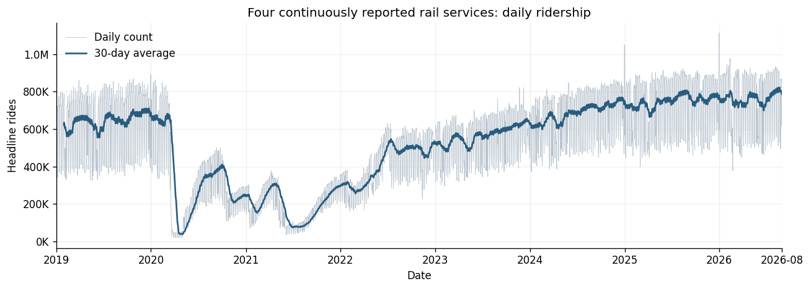
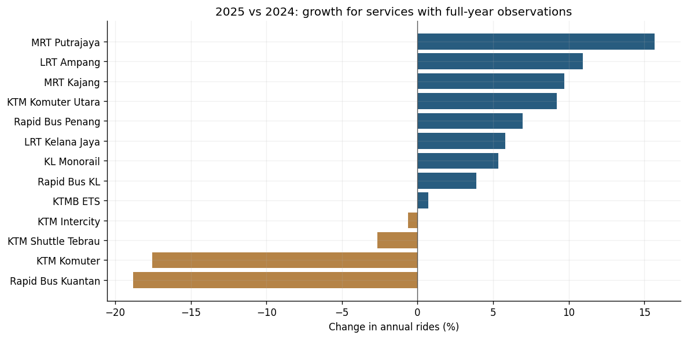

# Malaysia Public Transport Intelligence

> A reproducible, coverage-aware analysis of Malaysia's daily public transport ridership using Python, DuckDB SQL, Jupyter and Tableau-ready outputs.

[](https://www.python.org/)
[](https://pandas.pydata.org/)
[](https://duckdb.org/)
[](https://www.tableau.com/)
[](LICENSE)

## Project overview

This project investigates how reported public transport ridership changes across Malaysia over time, across services and across transport modes. It follows the data through a reproducible workflow:

1. **Ingest** an official open-data snapshot.
2. **Profile data quality and coverage** before calculating trends.
3. **Clean and reshape** the data conservatively while preserving unknown values.
4. **Analyze** demand, growth, seasonality, weekday/weekend patterns and variability.
5. **Reconcile results independently** with DuckDB SQL.
6. **Export evidence and Tableau-ready data** for interactive communication.

The core analytical challenge is **changing reporting coverage**. A higher aggregate total may reflect additional services entering the extract rather than a like-for-like increase in demand. For long-term comparisons, the project therefore uses a fixed four-service rail basket observed throughout the extract.

## Key findings

The latest complete calendar year in the supplied snapshot is **2025**; 2026 is excluded from full-year growth comparisons.

- Reported services recorded **451,121,402 headline rides in 2025**.
- **MRT Kajang** led 2025 reported ridership with **92,737,532 rides**, representing **20.6%** of the reported total.
- Among services with comparable complete-year observations, **MRT Putrajaya** recorded the strongest 2025 increase at **+15.7%** versus 2024.
- The fixed four-service basket—**LRT Ampang, MRT Kajang, LRT Kelana Jaya and KL Monorail**—recorded **274,490,644 rides in 2025**, up **8.4%** from 2024 and **16.2%** from 2019.
- Basket weekend daily ridership averaged **33.9% below weekdays** in 2025. This is a demand pattern, not proof of passenger purpose.
- Basket average daily ridership peaked in **July 2025 at 798,960 rides** and was lowest in **March at 700,174**.
- **684 service-day observations** meet the exploratory anomaly-screening rule. They remain in the analytical data and are not presented as confirmed disruptions or errors.





## Data and scope

The project uses the supplied snapshot of [Daily Public Transport Ridership](https://data.gov.my/data-catalogue/ridership_headline) from data.gov.my, sourced from Prasarana Malaysia and the Ministry of Transport.

| Attribute | Value |
|---|---|
| Coverage period | 2019-01-01 to 2026-08-31 |
| Calendar dates | 2,800 consecutive dates |
| Services | 14 reported services |
| Date-service cells | 39,200 total; 12,193 unreported |
| Main grain | One row per date and service |
| Latest complete year | 2025 |
| Data license | [CC BY 4.0](https://creativecommons.org/licenses/by/4.0/) |

The raw input is preserved unchanged. Its SHA-256 is recorded in [`data/processed/pipeline_manifest.json`](data/processed/pipeline_manifest.json).

### What the data does not measure

The dataset contains **headline rides**, not unique passengers. It does not provide a complete measure of all Malaysian public transport, punctuality, passenger origin-destination flows, capacity, crowding, timetable adherence or confirmed disruption causes.

## Technical workflow

### Python analysis

- Strict schema and type validation
- Date continuity and duplicate-key checks
- Conservative parsing of counts
- Preservation of null and zero distinctions
- Wide-to-long reshaping and reconciliation
- Coverage-aware annual and monthly comparisons
- Rolling averages and exploratory anomaly screening
- Reproducible figures and evidence tables

### DuckDB SQL

The SQL layer independently reproduces quality checks and analytical outputs using joins, CTEs, `CASE`, calendar logic, `LAG`, `LEAD`, `DENSE_RANK` and moving-window calculations—without requiring a database server.

### Tableau communication layer

The repository includes a Tableau-ready export and specifications for three dashboards:

1. **Executive Overview** — KPI summary, monthly trend, service ranking and mode contribution.
2. **Service Performance** — service rankings, growth comparisons, trends and weekday/weekend patterns.
3. **Ridership Patterns** — daily/monthly patterns, fixed-basket comparison, heatmap and volatility views.

Tableau resources:

- [`data/processed/tableau_ridership.csv`](data/processed/tableau_ridership.csv)
- [`tableau/README.md`](tableau/README.md)
- [`tableau/calculated_fields.md`](tableau/calculated_fields.md)

> **Tableau status:** The data export and dashboard specification are complete. A native Tableau workbook and verified Tableau Public link should be added here after the workbook is finalized and checked.

## Repository structure

```text
.
├── data/
│   ├── raw/                         # Supplied source snapshot
│   ├── processed/                   # Cleaned, reshaped and Tableau-ready data
│   └── README.md                    # Source, schema and coverage notes
├── images/                          # Reproducible analytical figures
├── notebooks/
│   ├── 01_data_ingestion_and_quality.ipynb
│   ├── 02_data_cleaning.ipynb
│   └── 03_exploratory_analysis.ipynb
├── reports/                         # Findings, evidence tables and SQL exports
├── scripts/
│   └── build_notebooks.py           # Execute and rebuild notebooks
├── src/
│   ├── config.py                    # Paths and reviewed service mapping
│   ├── data_cleaning.py             # Validation, cleaning and reshaping
│   ├── features.py                  # Coverage-aware analytical features
│   ├── analysis.py                  # Tables, figures and findings
│   └── sql_analysis.py              # DuckDB SQL runner
├── sql/
│   ├── schema.sql                   # Analytical schema
│   ├── data_quality.sql             # Independent quality checks
│   └── analysis.sql                 # Analytical queries
├── tableau/                         # Dashboard specification and calculations
├── tests/                           # Cleaning, SQL and edge-case tests
├── pyproject.toml
└── requirements.txt
```

## Reproduce the analysis

Python **3.10+** is required. From the repository root:

```bash
python -m venv .venv
```

Activate the environment:

```bash
# macOS / Linux
source .venv/bin/activate

# Windows PowerShell
.venv\\Scripts\\Activate.ps1
```

Install dependencies:

```bash
python -m pip install -r requirements.txt
```

Run the pipeline:

```bash
python -m src.data_cleaning
python -m src.analysis
python -m src.sql_analysis
python -m pytest -q
python scripts/build_notebooks.py
```

The notebook build command executes the three notebooks from top to bottom and refreshes their saved outputs. Paths resolve from the repository, so the workflow does not depend on machine-specific source locations.

The pipeline does not silently refresh the official dataset. To analyze a new snapshot, deliberately replace the raw input, review the service mapping, rerun validation, and inspect the resulting coverage changes.

## Validation and interpretation safeguards

The pipeline tests and checks include:

- Invalid dates and schemas
- Duplicate and conflicting keys
- Corrupted counts and negative values
- Missing calendar dates
- Null versus zero preservation
- Incomplete comparison periods
- Zero denominators in growth calculations
- Daily total reconciliation
- Domain and key validation in SQL
The pipeline reconstructs the full wide table from long rows, including null positions, and verifies daily totals, observation flags and service/mode mappings. Tests cover corrupted counts and metadata, conflicting duplicates, invalid dates/schema, zero denominators, incomplete comparisons and calendar gaps. SQL growth is compared with a fresh Python calculation from the raw snapshot rather than a saved report. SQL checks independently reconcile every raw daily sum and verify keys, domains and date continuity. The raw snapshot remains unchanged.

The anomaly screen compares each observation with the preceding eight matching weekdays and requires both an absolute z-score of at least 4 and an absolute deviation of at least 25%. It is an exploratory review aid, sensitive to holidays, trends and source reporting behavior. A flag does not establish a cause.

## Future work

The current analysis is intentionally limited to the supplied headline-ridership snapshot. The next development priorities are:

### Data and coverage

- Automate retrieval and versioning of new data.gov.my snapshots.
- Add an explicit data freshness check and release metadata.
- Improve service-level coverage diagnostics, especially for intermittent reporting and zero runs.
- Maintain a reviewed service dictionary when new services or naming conventions appear.

### Operational context

- Add timetable, service frequency, vehicle capacity and crowding data.
- Add station-level entries/exits and origin-destination flows where available.
- Add public-holiday, school-holiday, weather and major-event calendars.
- Link disruption, maintenance and incident records to anomaly candidates.

### Analysis

- Separate structural coverage changes from genuine demand changes using a formal comparison cohort.
- Model seasonality and calendar effects rather than relying only on descriptive comparisons.
- Test forecasting approaches with time-based validation.
- Investigate zero runs and anomaly candidates with operator-level source records.
- Quantify uncertainty around growth and service comparisons.

### Tableau and delivery

- Complete and validate the native Tableau workbook.
- Add dashboard screenshots and a verified Tableau Public URL.
- Add interactive service selection and parameterized metric switching.
- Improve accessibility with descriptive titles, color-safe palettes and screen-reader-friendly annotations.
- Add automated checks that compare Tableau-facing exports with the Python and SQL evidence tables.

## Project limitations

- The supplied snapshot ends on 2026-08-31; 2026 is incomplete.
- Reported services enter the extract at different times.
- Shah Alam has internal reporting gaps and must not be interpreted as zero demand when observations are absent.
- Weekend/weekday differences do not identify passenger purpose.
- The analysis cannot attribute changes to policy, capacity, timetable, disruption or economic causes without additional data.
- Growth comparisons are only meaningful when the comparison period and service coverage are complete and explicitly documented.

## Attribution and license

Data: [Daily Public Transport Ridership](https://data.gov.my/data-catalogue/ridership_headline), data.gov.my, from Prasarana Malaysia and the Ministry of Transport. Licensed under [CC BY 4.0](https://creativecommons.org/licenses/by/4.0/).

Code: [MIT License](LICENSE).

This is an independent portfolio project.
